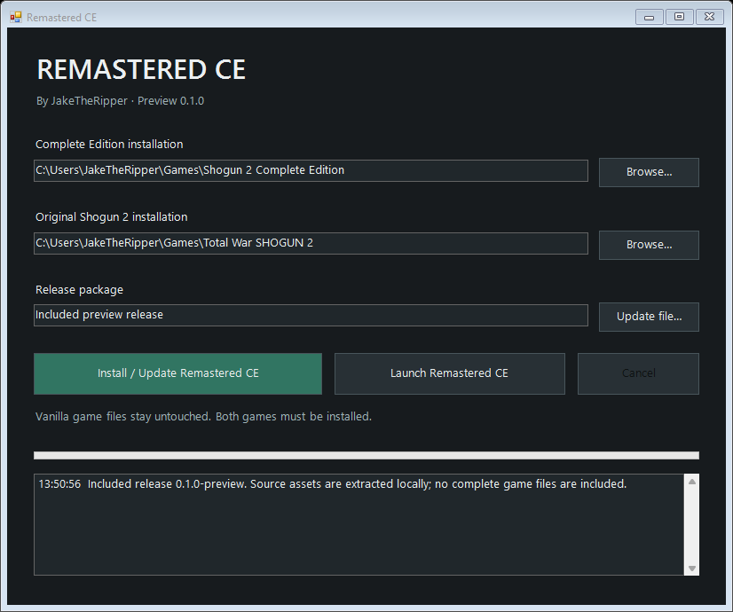

# Remastered CE

By **JakeTheRipper**.

Installer, updates, and release notes for Remastered CE for Shogun 2 Complete Edition.

## Download

[Download the installer preview](https://github.com/JakeTheRipperYT/Remastered-CE/releases/tag/v0.1.0-preview).

Extract the installer ZIP and run RemasteredCE_Setup.exe. Both Complete Edition and original Total War SHOGUN 2 must be installed. Select both game folders, close the game, and choose **Install / Update Remastered CE**.

**This is a testing preview.** Full file reconstruction and update rollback tests passed. The installer-generated build still needs an in-game smoke test before a general release.

The installer builds the separate RemasteredCE folder using local game files. Vanilla game files are not replaced. No complete game EXE, engine DLL, or game packs are supplied here.

For updates, download a signed `.rce` package, select **Update file...**, and install it. Automatic download checks are not implemented in this preview.

See [installation details and limitations](docs/README.md), [validation results](docs/self-tests.txt), and [third-party notices](THIRD_PARTY_NOTICES.txt).

